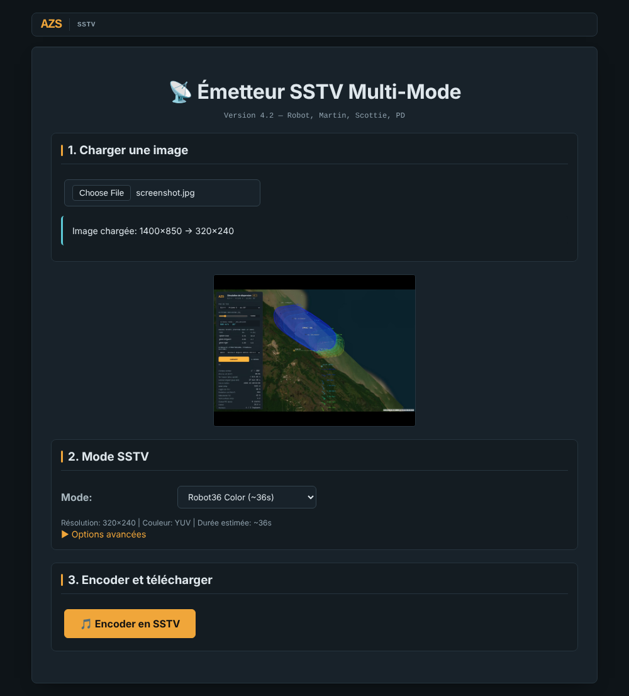
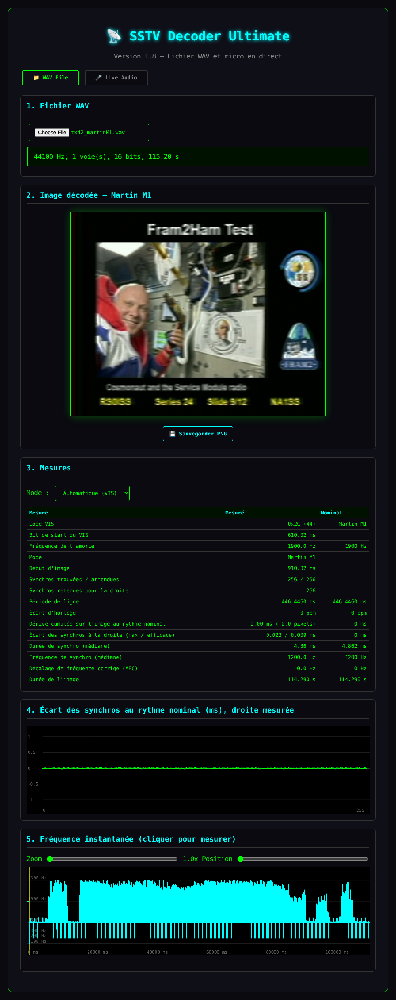
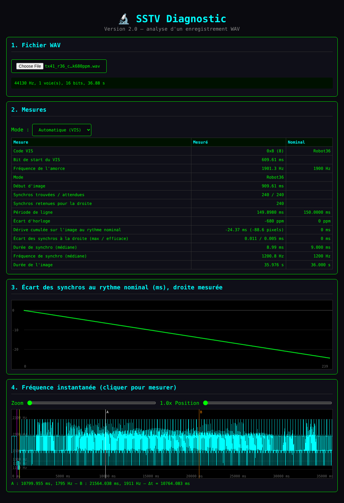

<!--
  Nom      : LISEZMOI.md
  Objet    : Présentation du dépôt sstv (émission, réception et diagnostic SSTV)
  Auteur   : Eric PERRET
  Date     : 2026-10-18
  Version  : 1.7
  Licence  : CC BY-NC 4.0
-->

# 📻 SSTV

🇬🇧 [English version: README.md](README.md)

Télévision à balayage lent (SSTV) dans le navigateur : émission d'une image en fichier audio, décodage d'un fichier ou du son en direct, diagnostic d'un enregistrement. Trois fichiers HTML autonomes, aucune librairie, aucune installation. Interfaces en français (diagnostic en français ou en anglais, selon le navigateur).

▶️ **[Page d'accueil des outils](https://ericperret.github.io/sstv/index2.html)**

| Outil | Lancer |
|---|---|
| Émetteur SSTV multi-mode v4 | ▶️ **[sstv_tx_multimode_v4.html](https://ericperret.github.io/sstv/sstv_tx_multimode_v4.html)** |
| SSTV Decoder Ultimate | ▶️ **[sstv_decoder_ultimate.html](https://ericperret.github.io/sstv/sstv_decoder_ultimate.html)** |
| SSTV Diagnostic | ▶️ **[sstv_diagnostic.html](https://ericperret.github.io/sstv/sstv_diagnostic.html)** |

---

## Émetteur SSTV multi-mode v4

| Fonction | Description |
|---|---|
| Image | Chargement d'une image, mise à l'échelle du mode choisi |
| Modes | Robot36 couleur et N&B, Robot72, Martin M1 / M2, Scottie S1 / S2, PD90, PD120, PD160, PD180, PD240 (durée affichée) |
| Signal | WAV PCM 16 bits mono 44,1 kHz, temps exact à l'échantillon (ligne Robot36 = 150,000 ms) |
| En-tête | Code VIS normalisé (bit de start, 7 bits, parité paire, bit de stop), mire de calibration 1 s à 1 900 Hz en option |
| Sortie | Fichier WAV téléchargé, à diffuser par un émetteur ou un haut-parleur |

## SSTV Decoder Ultimate

| Fonction | Description |
|---|---|
| Sources | Fichier WAV (8 / 16 / 24 / 32 bits ou flottant, mono ou stéréo, toute fréquence d'échantillonnage), ou micro en direct à sa fréquence native (adapté au téléphone, écran maintenu allumé) |
| Modes | Détection automatique par code VIS, ou forcé : Robot36 / 72, Martin M1 / M2, Scottie S1 / S2, PD90 à PD240 |
| Synchronisation | Tous les modes : synchro suivie ligne par ligne et horloge mesurée (pas d'inclinaison) ; correction de fréquence automatique (AFC) mesurée sur l'amorce du VIS et les synchros, jusqu'à ±250 Hz |
| Fichier WAV | Ouvrir un fichier lance le diagnostic intégré (VIS, mesures de synchro, écart d'horloge, dérive, tracés des écarts et de la fréquence) et décode aussitôt si le mode est connu |
| Micro | Choix de la famille (Robot, Martin, Scottie, PD) ; réception lancée par START ; les 5 dernières minutes sont gardées, toucher l'image les redécode dans le sous-mode suivant, même après STOP |
| Sortie | Export PNG de l'image décodée ; enregistrement WAV de la capture micro |

## SSTV Diagnostic

| Fonction | Description |
|---|---|
| Entrée | Tout fichier WAV (8 / 16 / 24 / 32 bits ou flottant, mono ou stéréo, toute fréquence d'échantillonnage) |
| Mesures | VIS normalisé, les 11 modes, synchros mesurées ligne par ligne : période de ligne, écart d'horloge (ppm), dérive cumulée (ms et pixels), durée et fréquence de synchro |
| Tracés | Écart des synchros au rythme nominal (une horloge fausse donne une pente) ; fréquence instantanée avec zoom et mesure A / B au clic |
| Langue | Français ou anglais, selon le navigateur |

---

## Versions

Les outils à la racine du dépôt sont la version **approuvée**. La version en cours est dans le dossier [dev/](dev/), mêmes noms de fichiers, en ligne sur ▶️ **[dev/index2.html](https://ericperret.github.io/sstv/dev/index2.html)**. Une version n'est copiée à la racine qu'une fois approuvée ; chaque version approuvée porte une étiquette (`tx-4.2`, `rx-1.8`, `diag-2.0`…).

## Radioamateurisme

La SSTV sert aux radioamateurs pour transmettre des images en HF / VHF. Ces outils permettent d'expérimenter sans émetteur, par câble audio ou couplage acoustique ; l'émission sur les bandes radioamateurs reste soumise à licence.

## Historique

| Version | Évolution |
|---|---|
| 2026-10-17 | Fichiers renommés sans suffixe de copie, cartouches, page d'accueil corrigée, README / LISEZMOI réécrits |
| 2026-10-17 | Émetteur 4.1 : VIS normalisé, temps exact, Robot36 corrigé. Décodeur 1.1 : détection VIS, tout format WAV, suivi de synchro Robot36. Validé par un décodeur externe et des enregistrements ARISS / PySSTV (Robot36 seul) |
| 2026-10-17 | Décodeur 1.2 : réception micro sur la même chaîne que les fichiers (VIS, suivi de synchro et horloge mesurée Robot36), testée en couplage acoustique simulé |
| 2026-10-17 | Décodeur 1.3 : micro laissé dans ses réglages par défaut (traitements du navigateur coupés sur demande), jauge de niveau en dBFS, enregistrement de la capture micro en WAV |
| 2026-10-17 | Décodeur 1.4 : aucun journal affiché ; onglet micro épuré : Robot36 seul, démarrage sur les synchros (VIS facultatif), bouton tactile des traitements audio utilisable pendant la capture, jauge -90 à 0 dBFS, enregistrement de la capture sous l'image |
| 2026-10-17 | Décodeur 1.5 : réception micro lancée au clic sur START sans attendre VIS ni synchro, en continu jusqu'à STOP (les images s'enchaînent), accrochage sur la première synchro trouvée ; un VIS Robot36 recale l'image en haut |
| 2026-10-17 | Décodeur 1.6 : micro avec annulation d'écho et réduction de bruit coupées, préampli (gain automatique) actif avec un bouton pour le couper ; téléchargement PNG et WAV corrigé sur Chrome Android |
| 2026-10-18 | Approuvé : émetteur 4.1, décodeur 1.6. En cours dans [dev/](https://ericperret.github.io/sstv/dev/index2.html) : émetteur 4.2 (Robot72 corrigé, PD90 / PD160 / PD240), décodeur 1.7 (tous les modes avec suivi de synchro, choix de la famille au micro, tampon de 5 minutes redécodé en touchant l'image) |
| 2026-10-18 | Approuvé : diagnostic 2.0 |
| 2026-10-18 | En cours dans dev/ : décodeur 1.8, onglet fichier avec le diagnostic intégré : ouvrir un WAV lance les mesures et décode aussitôt si le mode est connu (VIS ou choisi) ; correction de fréquence automatique (AFC) mesurée sur l'amorce du VIS et les synchros, jusqu'à ±250 Hz ; boutons Analyser / Décoder, Doppler manuel, forme d'onde et spectrogramme supprimés |
| 2026-10-18 | Approuvé : émetteur 4.2, décodeur 1.8 |
| 2026-10-18 | En cours dans dev/ : décodeur 1.9, micro avec tous les traitements du navigateur coupés, gain automatique (préampli) compris ; bouton Préampli supprimé |
| 2026-10-18 | En cours dans dev/ : décodeur 1.10, variante N&B de chaque mode (même signal, luminance seule : Y transmis pour Robot et PD, luminance BT.601 des voies R, V, B pour Martin et Scottie), chaque mode suivi de sa variante N&B au toucher de l'image, variantes N&B dans le sélecteur du mode fichier ; émetteur 4.3, « Robot36 N&B » non standard retiré |
| 2026-10-18 | En cours dans dev/ : décodeur 1.11, état du micro vérifié sans demande d'autorisation : START grisé si micro absent, accès refusé ou page non sécurisée, raison affichée au clic et en cas d'échec au démarrage ; capture par ScriptProcessor si l'AudioWorklet ne se charge pas (page ouverte en fichier local) |
| 2026-10-18 | En cours dans dev/ : décodeur 1.12 et émetteur 4.4, interface en français ou en anglais selon la langue du navigateur (aucun réglage) ; mise en page de l'émetteur adaptée au téléphone |

## Licence

[CC BY-NC 4.0](https://creativecommons.org/licenses/by-nc/4.0/deed.fr) — voir [LICENSE (CC BY-NC 4.0)](<LICENSE (CC BY-NC 4.0)>).

## Auteur

**Eric PERRET** — [GitHub](https://github.com/ericperret)
